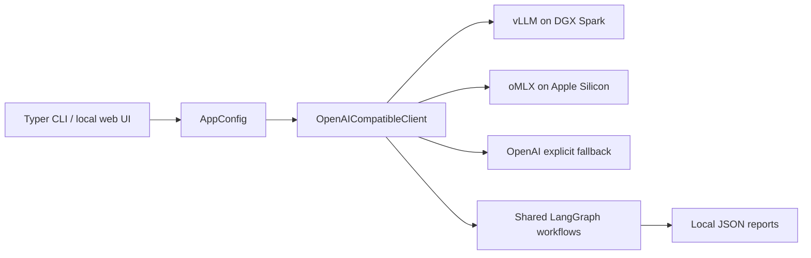

# LangGraph STRIDE


LangGraph STRIDE generates STRIDE/DREAD threat models and CVE/CTI threat scenarios through one provider-neutral inference path. The same code runs against vLLM on NVIDIA DGX Spark and oMLX on Apple Silicon; platform detection changes defaults, never workflow logic.



| Host | Backend | Device | Concurrency |
|---|---|---|---:|
| Linux/ARM64 | vLLM | CUDA | 2 |
| Darwin/ARM64 | oMLX | MPS | 4 |
| Other | oMLX | CPU | 4 |

## Quickstart

```bash
python3.11 -m venv .venv
source .venv/bin/activate
pip install -e ".[dev]"
python -m src.cli info
```

With an OpenAI-compatible endpoint running:

```bash
python -m src.cli models --inference-url http://127.0.0.1:8000
python -m src.cli smoke-inference --inference-url http://127.0.0.1:8000
```

On DGX Spark use `./setup_and_run_dgx.sh doctor`, then `setup`, `llm-up`, and `smoke`. On Apple Silicon, `./setup_and_run_macos.sh info` creates or reuses a Conda environment. See [the DGX guide](docs/DGX_SPARK.md).

Provider-neutral options accept the aliases `--vllm-url`/`--omlx-url`, `--vllm-model`/`--omlx-model`, and `--vllm-api-key`/`--omlx-api-key`. Copy selected values from `.env.example` into a private `.env`; exported shell values win.

The threat-model, scenario, and browser-console commands are added as their milestones turn green. The immutable mapping and acceptance criteria live in `PORT_PLAN.md`.

## Development

```bash
./gate.sh
```

The gate checks formatting, lint, all tests, an import smoke, and end-to-end CLI requests against both vLLM and oMLX mock personas.

