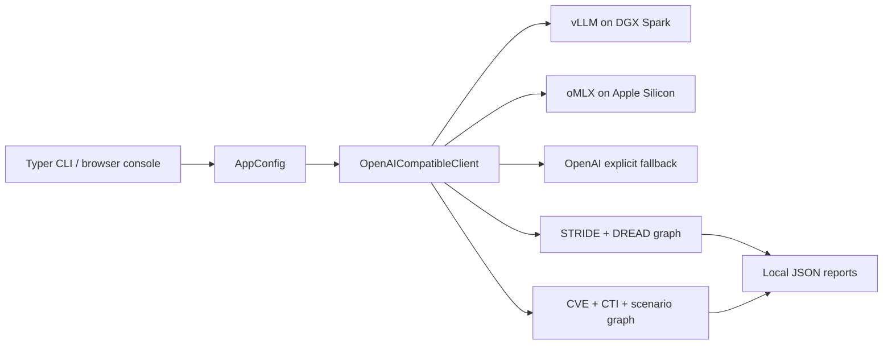

# LangGraph STRIDE


LangGraph STRIDE turns application inventory into STRIDE/DREAD threat models, then into CVE, CTI, and cyber-threat scenario reports. One codebase runs against vLLM on NVIDIA DGX Spark and oMLX on Apple Silicon through the same OpenAI-compatible client. Platform detection changes defaults, never workflow logic.



| Component | Responsibility |
|---|---|
| `src/config.py` | Host detection, environment resolution, and Pydantic config tree |
| `src/inference_client.py` | URL normalization, model discovery, thinking removal, context/truncation policy, and shared client cache |
| `src/threat_model.py` | Six-node STRIDE/DREAD generation, QA retry, final QA, and persistence graph |
| `src/scenario.py` | Eight-node CVE/CTI/scenario selection, generation, approval, and persistence graph |
| `src/gui.py` + `src/web/` | Local job console, report browser, logs, and safe static/JSON serving |
| `src/workspace.py` | Workspace CMDB, attack-chain library, and Application → model → scenario navigator |
| `src/maintain/` | Maintain studio: novel chain forge, clone autopsy, force-layout viz, Neo4j projection |
| Platform helpers | Checked DGX/vLLM and Apple/oMLX setup, launch, doctor, and smoke paths |

### Attack-template Neo4j (optional, dedicated)

Separate from TwinOps. See [docs/NEO4J.md](docs/NEO4J.md).

```bash
docker compose -f compose.neo4j.yaml up -d   # browser :7475, bolt :7688
python -m src.cli maintain neo4j-sync
# Open Maintain in the console for co-occurrence / bipartite / dark-matter views
```

## Platform defaults

| Host | Backend | Device | Concurrency |
|---|---|---|---:|
| Linux/ARM64 | vLLM | CUDA | 2 |
| Darwin/ARM64 | oMLX | MPS | 4 |
| Other | oMLX | CPU | 4 |

`STRIDE_BACKEND`, `STRIDE_DEVICE`, and `STRIDE_CONCURRENCY` override these defaults. The workflow code is identical on every host.

## Install

### Manual development install

```bash
python3.11 -m venv .venv
source .venv/bin/activate
pip install -e ".[dev]"
python -m src.cli info
./gate.sh
```

### Apple Silicon

Start an oMLX OpenAI-compatible server, set `MLX_MODEL` if its served model is not named `default`, then run:

```bash
./setup_and_run_macos.sh serve
```

The helper creates or reuses a Conda Python 3.11 environment, preserves any existing `.env`, installs the development package, selects oMLX/MPS/concurrency four, and opens the local console at `http://127.0.0.1:8765`.

### NVIDIA DGX Spark

```bash
(umask 077; touch .env)
chmod 600 .env
# Add HF_TOKEN only if no matching shared vLLM service is already running.
./setup_and_run_dgx.sh doctor
./setup_and_run_dgx.sh setup
./setup_and_run_dgx.sh llm-up
./setup_and_run_dgx.sh smoke
./setup_and_run_dgx.sh run serve
```

The helper reuses only an exact model/context service, refuses to replace a different port owner, and stops or tails only this repository's Compose container. See [the DGX Spark guide](docs/DGX_SPARK.md).

## Configuration

Create a private file without making secrets world-readable:

```bash
(umask 077; touch .env)
chmod 600 .env
```

Shell exports win over `.env`. Root or dashboard endpoint URLs are normalized to `/v1`.

| Variable | Purpose / fallback |
|---|---|
| `STRIDE_BACKEND` | `vllm`, `omlx` (`mlx` alias), or explicit `openai` |
| `STRIDE_DEVICE` | Host execution label: `cuda`, `mps`, or `cpu` |
| `STRIDE_CONCURRENCY` | Workflow concurrency default; Spark stays at two |
| `STRIDE_CONTEXT_SIZE`, `STRIDE_MAX_TOKENS` | Served context and requested-output ceiling |
| `STRIDE_ENABLE_THINKING` | Set `1` to enable thinking/reasoning; tags are still stripped from final content |
| `STRIDE_REASONING_STRENGTH` | Muse Glimmer budget when thinking is on: `low`, `medium`, `high` (default), `xhigh` |
| `NVD_API_KEY` | Optional key for higher rate limits on `intel update-nvd` |
| `STRIDE_METRICS_PORT` | Optional Prometheus endpoint for a `threat-model` run; unset by default |
| `VLLM_BASE_URL`, `VLLM_API_KEY`, `VLLM_MODEL` | DGX/vLLM persona; local key defaults to `local` |
| `VLLM_MAX_MODEL_LEN` | Compose ceiling and exact-service readiness requirement |
| `MLX_BASE_URL`, `MLX_API_KEY`, `MLX_MODEL` | Apple/oMLX persona; `OMLX_*` aliases are accepted |
| `OPENAI_BASE_URL`, `OPENAI_API_KEY`, `OPENAI_MODEL` | Optional hosted compatibility path |
| `LLM_TIMEOUT` | HTTP timeout in seconds |

The remaining image, revision, cache, memory, timeout, Conda, and Python settings are documented beside their defaults in `.env.example`.

## Commands

All direct inference commands accept provider-neutral options plus `--vllm-*` and `--omlx-*` aliases for URL, model, and key.

```bash
# Resolved settings and served models
python -m src.cli info --json
python -m src.cli models --inference-url http://127.0.0.1:8000
python -m src.cli smoke-inference --inference-url http://127.0.0.1:8000

# STRIDE + DREAD for the bundled sample application
# Muse Glimmer comparison: off vs on with a budget level
#   python -m src.cli threat-model AA987654 --backend openai --no-thinking
#   python -m src.cli threat-model AA987654 --backend openai --thinking --reasoning-strength medium
python -m src.cli threat-model AA123456

# CVE + CTI + threat scenario from the generated model
python -m src.cli scenario \
  --json-file output/stride/security_assessment_AA123456_TIMESTAMP.json \
  --attack-template "Zero-Day Exploit [New]" \
  --min-cvss 8.5

# Local browser console
python -m src.cli serve --host 127.0.0.1 --port 8765

# Workspace CMDB + attack chains (seeded from package fixtures into output/workspace/)
python -m src.cli cmdb seed
python -m src.cli cmdb list
python -m src.cli cmdb upsert --aa-id AA000001 --name "New App" --platform "Linux"
python -m src.cli chains list
python -m src.cli chains show "API Exposure Attack [New]"
python -m src.cli navigator

# Intel catalogs (offline first; online is operator-triggered only)
python -m src.cli intel status
python -m src.cli intel seed-nvd
python -m src.cli intel ingest-nvd path/to/nvd.json
python -m src.cli intel update-nvd --max-pages 2          # needs network; optional NVD_API_KEY
python -m src.cli intel search-cve --min-cvss 8.5 --q linux
python -m src.cli intel ingest-mitre path/to/enterprise-attack.json
python -m src.cli intel update-mitre                      # needs network
python -m src.cli intel search-mitre --q T1190
python -m src.cli intel ingest-cti path/to/pack.json
python -m src.cli intel list-cti

# PDF export from a saved assessment or scenario JSON
python -m src.cli export-pdf --json-file output/stride/security_assessment_AA123456_TIMESTAMP.json
```

Scenario CVE generation prefers the local NVD SQLite store (`output/workspace/intel/nvd/cve.sqlite` or `--db-path`). If the store is empty, it falls back to the packaged demo CVE fixture.

The browser console now includes Applications, Navigator, Intel, Reports (with Export PDF), and Activity. Workflow jobs print `STAGE:` lines so the live log shows progress.

## Inputs and outputs

- `src/data/cmdb.json`: three public sample application records (**seed only**).
- `src/data/predefined_attack_templates.json`: 27 MITRE ATT&CK-oriented **attack chains** (technique lists; seed only).
- `src/data/demo_critical_vulnerability.json`: deterministic CVE input / NVD fallback.
- `src/data/control_taxonomy.csv`: 20 source rows / 19 unique control IDs.
- `src/prompts/`: current STRIDE, DREAD, QA, CVE, CTI, and scenario prompt assets.
- `output/workspace/cmdb.json`: mutable CMDB after `cmdb seed` / GUI edits.
- `output/workspace/attack_templates.json`: mutable attack-chain library.
- `output/workspace/intel/nvd/cve.sqlite`: local CVE store (ingest/update NVD).
- `output/workspace/intel/mitre/techniques.json`: local ATT&CK technique catalog.
- `output/workspace/intel/cti/packs/`: CTI pack JSON files.
- `output/workspace/intel/manifest.json`: catalog freshness metadata.
- `output/stride/`: timestamped security assessments (include `_meta` lineage).
- `output/feedback/`: STRIDE, DREAD, and final-QA decisions.
- `output/scenarios/`: second-resolution scenario reports with source threat-model lineage.
- `output/exports/`: generated PDF reports.

`output/`, `logs/`, `.env`, local model caches, and virtual environments are gitignored.

## Project structure

```text
.
├── src/                  # Python package, runtime data/prompts, and web assets
│   ├── data/             # public sample inputs
│   └── prompts/          # source-derived prompts and report templates
├── tests/                # unit, platform, GUI, and dual-persona contract tests
├── docs/DGX_SPARK.md
├── compose.dgx-spark.yaml
├── setup_and_run_dgx.sh
├── setup_and_run_macos.sh
├── gate.sh
└── PORT_PLAN.md          # immutable source inventory and acceptance map
```

## Verification

```bash
./gate.sh
```

The gate checks Ruff formatting/lint, the full pytest suite, a CLI import smoke, and real CLI subprocesses against both bundled mock personas. Live GPU/MPS/model checks stay in launcher `smoke`, never pytest.

## Roadmap

- Connect the retained `--db-path` option to a real CVE database behind a tested data seam.
- Add CI runners for Linux/x86 portability plus scheduled on-hardware DGX Spark and Apple Silicon smoke checks.
